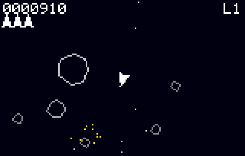
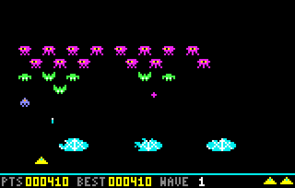
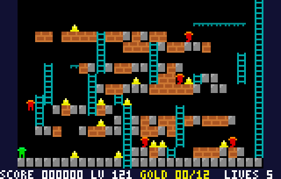
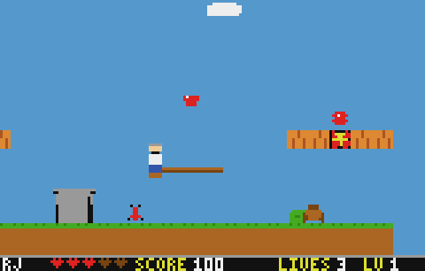

# lynx_games

Games for the Atari Lynx, built with [lynxdev](https://github.com/geekychris/lynxdev)
(cc65 in Docker, a patched Handy that tests drive headless, an MCP server
for Claude Code). Mostly ports of the Amiga originals in
[amiga_games](https://github.com/geekychris/amiga_games), redone for
the Lynx's 160x102 screen with Suzy sprites and Mikey sound.

This repo is lynxdev's `games/` submodule: build and test the games from a
lynxdev checkout.

```sh
git clone --recurse-submodules https://github.com/geekychris/lynxdev && cd lynxdev
./setup.sh
./lynx run rock_blaster        # in a window
./lynx test frank_the_frog     # headless play-through
```

## Games

| | Game | What it is |
|---|---|---|
|  | [Rock Blaster](rock_blaster) | vector rock shooter: the original's ship, rocks and rules; Suzy sprites (pre-rotated + flipped ship, scaled title logo), the original's tune on Mikey, 50 fps |
|  | [Frank the Frog](frank_the_frog) | hop Frank over five lanes of traffic and a river of logs and lily pads into the four ponds; Suzy-scaled title, Mikey sound, 50 fps; a bot test fills all four ponds |
|  | [Nova Defense](nova_defense) | invaders-style: a staggered swarm of 48 aliens in three kinds, a bonus comet, eroding crystal shields, the march speeding up as the swarm thins; 65 Suzy sprites a frame with an erase pass instead of a clear, the original's march, effects and arpeggio on Mikey, 50 fps |
|  | [Bullion Dash](bullion_dash) | dig traps, take the gold, climb out: all 150 repaired levels on one 160x102 screen (5x6 tiles), the original's fixed guards and path search, its four-channel tune on Mikey; bot tests win levels by route search |
|  | [Jump Quest](jump_quest) | RJ and Dale's side-scrolling platformer: the original's physics, enemies, items and three levels, all 14 rows on screen; tiles scrolled with Suzy's HOFF, the original's tune on Mikey, 46-50 fps; a bot game and the solver's routes through all three levels |

## Layout

One directory per game at the root:

```
<game>/Makefile      NAME := <game>; LYNX_SDK ?= ../../sdk; include $(LYNX_SDK)/project.mk
<game>/src/          C and ca65 sources (+ generated sprite data)
<game>/art/, tools/  sprite art and the scripts that convert it (./lynx sprite)
<game>/test.py       headless play-through (lynxdev's Emulator), asserts via log lines
<game>/README.md     controls, what's kept from the original, how it's tested
<game>/images/       screenshot (+ gif) for the READMEs
```

`LYNX_SDK ?= ../../sdk` resolves to lynxdev's `sdk/` because the game sits at
`lynxdev/games/<game>`.

## Licence

MIT, as lynxdev.
