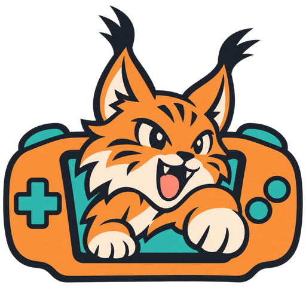
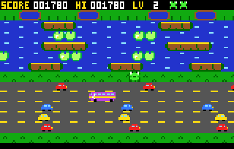
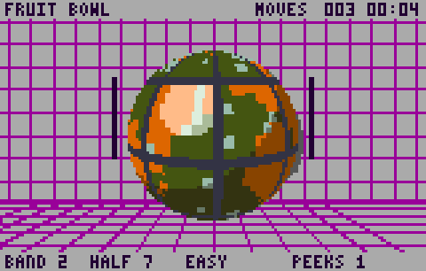
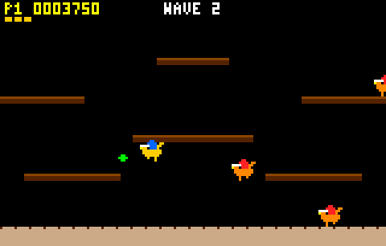
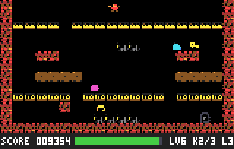
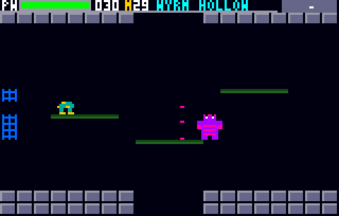

<p align="center">
  
</p>

# lynx_games

Games for the Atari Lynx, built with [lynxdev](https://github.com/geekychris/lynxdev)
(cc65 in Docker, a patched Handy that tests drive headless, an MCP server
for Claude Code). Mostly ports of the Amiga originals in
[amiga_games](https://github.com/geekychris/amiga_games), redone for
the Lynx's 160x102 screen with Suzy sprites and Mikey sound.

This repo is lynxdev's `games/` submodule: build, play and test the games
from a lynxdev checkout.

## How to play

1. **Install lynxdev** (it brings this repo along as `games/`). While both
   repos are private you need access to them and the GitHub CLI logged in
   (`gh auth login`):

   ```sh
   gh api -H "Accept: application/vnd.github.raw" repos/geekychris/lynxdev/contents/scripts/install.sh | bash
   ```

   or by hand:

   ```sh
   git clone --recurse-submodules https://github.com/geekychris/lynxdev && cd lynxdev
   ./setup.sh
   ```

   Details, other systems and troubleshooting: lynxdev's
   [docs/install.md](https://github.com/geekychris/lynxdev/blob/main/docs/install.md).

2. **Open the arcade**, the games menu, from the lynxdev directory:

   ```sh
   ./lynx arcade
   ```

   Type a game's number to build it and play it in a window, `i` + number
   for its controls, `q` to quit. Closing the game's window (Esc) brings
   you back to the menu.

3. **Keys in the window:** arrows = d-pad, Z or Left Alt = A (outer
   button), X / Left Ctrl / Cmd = B (inner), 1 / 2 = OPTION 1 / 2, P or
   Return = PAUSE, Esc closes the window. Each game's README has its
   controls.

One game straight away: `./lynx run rock_blaster`. A headless play-through
test: `./lynx test frank_the_frog`.

Already have lynxdev? `git pull && git submodule update --init` in it
picks up new games.

## Games

| | Game | What it is |
|---|---|---|
|  | [Rock Blaster](rock_blaster) | vector rock shooter: the original's ship, rocks and rules; Suzy sprites (pre-rotated + flipped ship, scaled title logo), the original's tune on Mikey, 50 fps |
|  | [Frank the Frog](frank_the_frog) | hop Frank over five lanes of traffic and a river of logs and lily pads into the four ponds; Suzy-scaled title, Mikey sound, 50 fps; a bot test fills all four ponds |
|  | [Nova Defense](nova_defense) | invaders-style: a staggered swarm of 48 aliens in three kinds, a bonus comet, eroding crystal shields, the march speeding up as the swarm thins; 65 Suzy sprites a frame with an erase pass instead of a clear, the original's march, effects and arpeggio on Mikey, 50 fps |
|  | [Bullion Dash](bullion_dash) | dig traps, take the gold, climb out: all 150 repaired levels on one 160x102 screen (5x6 tiles), the original's fixed guards and path search, its four-channel tune on Mikey; bot tests win levels by route search |
|  | [Jump Quest](jump_quest) | RJ and Dale's side-scrolling platformer: the original's physics, enemies, items and three levels, all 14 rows on screen; tiles scrolled with Suzy's HOFF, the original's tune on Mikey, 46-50 fps; a bot game and the solver's routes through all three levels |
|  | [Boing Twist](boing_twist) | the twisty puzzle on the Boing ball: twist bands and flip halves until the picture is whole; the original's rules, 17 pictures and ten rooms; the ball drawn by the 6502 from its texture into a Suzy sprite, the title's Boing ball turned by colour cycling, Suzy-scaled previews, stretch/tilt floors; a bot test solves a scramble |
|  | [Sky Knights](sky_knights) | joust on flying mounts: flap above the enemy knights, take their pods before they hatch; the original's rules in its 320x256 world drawn at 160x102, Suzy sprites with an erase pass instead of a clear, the original's tune on Mikey, 50 fps; a bot test plays four waves |
|  | [Miner Meteor](miner_meteor) | single-screen platformer: keys, a locked exit, spikes, conveyors, crumbling floors, guardians and draining air in the original's six caverns, 8x7 tiles from its tile sheet; drawn once, then only the dirty cells and four sprites a frame, Mikey effects, 50 fps; the solver's routes clear all six caverns |
|  | [Orb Hunter](orb_hunter) | explore the lost caverns: 48 rooms of the original's world (its levels.c), six creatures and two bosses, nine power-ups (roll form, bombs, rockets that open barred doors); a whole room on screen in 8x6 tiles, painted once then only the dirty cells, Suzy sprites, the original's tune on Mikey, 50 fps; a bot test plays a game |
|  | [Lunar Rider](lunar_rider) | moon buggy: jump craters and rocks, dodge mines, shoot rocks, UFOs and meteors forward and upward, a checkpoint every 500 pixels; the original's rules and screens, parallax mountains as 256-wide Suzy strips, the bouncy bass on Mikey, 50 fps; a bot plans its jumps with the game's own rules |

## Layout

One directory per game at the root:

```
<game>/Makefile      NAME := <game>; LYNX_SDK ?= ../../sdk; include $(LYNX_SDK)/project.mk
<game>/src/          C and ca65 sources (+ generated sprite data)
<game>/art/, tools/  sprite art and the scripts that convert it (./lynx sprite)
<game>/test.py       headless play-through (lynxdev's Emulator), asserts via log lines
<game>/README.md     controls, what's kept from the original, how it's tested
<game>/images/       screenshot (+ gif) for the READMEs
```

`LYNX_SDK ?= ../../sdk` resolves to lynxdev's `sdk/` because the game sits at
`lynxdev/games/<game>`.

## Writing a game

`./lynx new --game <name>` in lynxdev creates `games/<name>/` from the
template. lynxdev's [getting-started](https://github.com/geekychris/lynxdev/blob/main/docs/getting-started.md)
and [game-dev](https://github.com/geekychris/lynxdev/blob/main/docs/game-dev.md)
docs walk through it; [CLAUDE.md](CLAUDE.md) has the rules for PRs here.

## Licence

MIT ([LICENSE](LICENSE)), as lynxdev.
