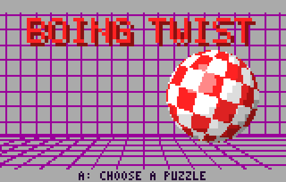
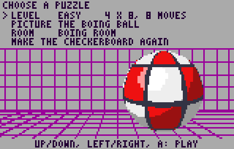
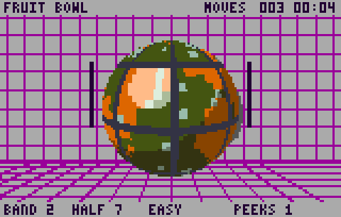

# Boing Twist (Atari Lynx)

Port of `amiga_mcp/examples/boing_twist` (AmigaOS 4): a twisty puzzle on the
Boing ball. A picture is wrapped round the ball, the ball is cut into tiles
along lines of latitude and longitude, and the tiles are jumbled. Twist
bands of tiles round the ball and flip halves of it over until the picture
is whole again. The ball sits in a room, the first the 1984 Boing demo's
grey room with its purple grid; on the title the Boing ball bounces round
it, spinning, its shadow on the back wall, and when you solve a puzzle your
ball bounces the same way.

 



```sh
./lynx build boing_twist            # RELEASE=1: no harness log
./lynx run boing_twist              # in a window
./lynx test boing_twist             # a bot plays it (test.py)
```

## Controls

| Lynx | | window keys |
|---|---|---|
| d-pad UP / DOWN | choose the band (the bars beside the ball) | arrow keys |
| d-pad LEFT / RIGHT | twist it one tile west / east | arrow keys |
| B held + LEFT / RIGHT | choose the half (the ball turns to face it) | X + arrows |
| B held + UP / DOWN | turn the ball to look | X + arrows |
| A | flip the half facing you | Z |
| OPTION 1 | undo | 1 |
| OPTION 2 held | peek at the picture | 2 |
| PAUSE | pause; then PAUSE goes on, A a new scramble, B give up (it solves itself, move by move), OPTION 1 the title, OPTION 2 the room | P or Return |
| title | A or PAUSE: choose a puzzle; OPTION 2 the room | |
| select | UP / DOWN: the level, the picture, the room; LEFT / RIGHT change it; A plays; B the title | |
| solved | A: another puzzle; B: the title | |

The original's keys, for comparison: arrows choose the band and twist it,
A / D the half, Space flips, Q / E turn the ball, U undoes, H peeks, P
pauses, N a new scramble, R gives up, T the room.

## The puzzle (the original's, unchanged)

The ball is cut into B bands by S segments; the level sets the grid and
the scramble: Easy 4 x 8 scrambled by 8 moves, Medium 6 x 12 by 20, Hard
8 x 16 by 40, Expert 8 x 16 by 80. A twist turns a band one tile east or
west; a flip turns the S/2 segments either side of a meridian 180 degrees
about the horizontal axis through the middle of that half (a piece in band
b goes to band B-1-b, mirrored, upside down). The ball is solved when every
tile shows the picture that belongs there, allowing for the whole ball spun
round; tiles that look the same count as the same, so the Boing ball (Easy
only) is "make the checkerboard again". A level offers the pictures that
suit it or an easier one. Your best moves and time for each picture and
level are kept (until the Lynx is switched off: the original keeps them in
a file).

`src/bt_core.c` is the original's file (rules, scrambles, undo, the solved
test, the RNG) with `port:` changes for cc65 only: two big local arrays
static, two struct initialisations split, the history 760 moves instead of
1024, `bt_start_level`'s copy of the signatures in the play memory, and the
self-test's long run and `bt_level_from_name` left out (memory). The test
checks a scramble's hash against the same file compiled on the host.

## What's kept, what changed

Kept: the rules and levels; all 17 pictures and the Boing checkerboard,
each choosing its room; the ten rooms (the Boing room, Midnight Box, Deep
Space and the seven from the artwork) with their colours, grids, side walls
and ceilings, drawn with the original's camera and box (45 degree lens,
back wall 6.5 away, floor 1.5 down, grid of 0.5); the shadow on the back
wall or the floor as each room has it; the original's light (fixed to the
eye, diffuse and a highlight); the play view (the ball 3.6 away, tipped 12
degrees towards you); the move queue, each move animated and applied when
it ends (a twist 240 ms, a flip 420 ms, faster while scrambling or giving
up), undo, peek, pause, give up, a new scramble, the timer from the first
move, the turn to face the chosen half; the title's bounce (the 1984 demo:
across the room, leaning -17 degrees, spinning 70 degrees a second) and the
solved screen's bounce; the sounds (thud, click, whoosh, chord), no music,
as the original.

Changed (marked `port:` in the source):

- **The picture** is 64 x 32 texels round the ball in three colours (made
  by `tools/gen_data.py`; the original's is 1024 x 512, 24-bit). The
  grooves between tiles are the first texel row and column of each tile,
  dark (the original draws its grooves into the picture too); Hard and
  Expert's 4-texel tiles have none (as the Atari 8-bit port).
- **The selection**: the band is marked by bars either side of the ball
  (the original draws yellow rings on it); the half is the one facing you
  (the ball turns to it).
- **A flip** turns the ball to face the half first (as the Atari 8-bit and
  Spectrum ports), then turns the half about its axis.
- No tilting or zooming the ball, no mouse, no help screen; the select
  screen's ball is a little further away (under its rows of text). The
  solved ball bounces upright (the original leans it as it bounces).
- The textured rooms (the artwork's walls and floors) are their average
  colours, the Deep Space room's stars are 40 dots.
- Scoring: none, as the original (the best moves and time per picture and
  level). The Atari 8-bit and Spectrum ports add a score for each solve and
  a high-score table with initials; it would be an easy addition here.

## How it is drawn

The screen is 160 x 102 in 16 colours: 0-4 the room (background, back
wall, floor, grid, shadow), 5 the text and markers, 6-15 the ball.

- **The ball** is a 64 x 64, 4-bit Suzy sprite drawn by the 6502 from the
  texture (`view_play` in `src/ballasm.s`) through tables made on the host
  (`src/view.s`): for every pair of pixels the texels they show at turn 0;
  the turn is added to each row's address, so turning the ball costs
  nothing. A texel is 4 | c in both nibbles; the light is baked into each
  pair as an EOR that makes it the lit (4 | c), dark (8 | c) or highlight
  (12 | c) pen, and the SCB's pen palette maps those to the picture's
  colours lit three ways. 97k cycles for the 3,228 pixels (1.25 frames at
  50 Hz).
- **A twist** shifts the band's texture rows (`band_rotate`). **A flip**:
  at its start the half is resampled round the flip axis into a polar copy
  (16 rings x 64 angles, `flip_begin`); each frame the half's texels are
  read back from it turned by the flip's angle (`flip_frame`), so the
  flipping half is drawn by the same code. After a move the texture is
  rebuilt from the puzzle (`tex_rows`, in asm: 63k cycles a band, about
  half the ball after a flip).
- **Suzy's scaling**: the select screen's preview and the solved screen's
  bouncing ball are the play sprite scaled (0.86 and 0.84); the shadow is
  a 32 x 32 disc scaled to its ellipse; the title's logo zooms in from
  nothing to 2x; the rooms' floors are single trapezoids (a 1-pixel sprite
  with Suzy's stretch and tilt), and so are the floor's grid lines running
  away from you; the back wall's vertical grid lines are one 1-bit row
  stretched down the wall (`src/roomasm.s` builds the SCBs).
- **The title's Boing ball** is turned the way the 1984 demo turned it:
  colour cycling. It is drawn once on the host (52 x 52, leaning -17
  degrees); each pixel's pen is its phase, 1 + (its longitude in 1/7ths of
  a square + 7 x its row's parity) mod 14, so cycling which pens are red and
  which white spins it (the demo's 14 steps). The light is baked in as
  zones: 46 sub-sprites (rows in fours, split where the light's step
  changes), each light step's pen palette (red and white at that
  brightness) cycled each frame, the other sub-sprites of a step reusing it
  (`REUSEPAL`).
- **Play is single-buffered**: the room is drawn once, the ball is redrawn
  in place just after the vertical blank (tear-free: Suzy finishes before
  the beam reaches it), the markers are written straight into the screen
  (what the room has under them is saved). The other screens are double
  buffered (the bounce redraws the room every frame).

## Memory

64 KB of RAM: the program, its data and BSS fill `$0200-$B996` (harness
build; the release build ends at `$B4E0`), 1 KB of C stack, the two
screen buffers `$C038` and `$E018`. What doesn't fit is on the cartridge
and read when needed (`lynx_load`; `src/directory.s` is the cartridge's
directory, `tools/gen_data.py` writes it, `src/cart.s` and
`boing_twist.cfg`):

| | |
|---|---|
| the 17 pictures | 512 bytes each, read into `pic_buf` when chosen |
| the ten rooms' shapes | up to 507 bytes each, read into `room_buf` when the room changes |
| the title ball's sub-sprites | 1,582 bytes, read into the texture's place (the title shows no picture) |
| the flip's tables | 3,289 bytes, read into the second screen buffer when a game starts |

While playing, the second screen buffer (single buffering) holds the
flip's tables, its polar copy, a twisting band's rows, the puzzle (2.8 KB)
and the move queue (`src/ball.h`; of `$E018-$FFF7` the CPU only sees RAM
at `$E018-$FBFF` and `$FE00-$FFF7`: Suzy and Mikey's registers are at
`$FC00-$FDFF`). The cartridge is 55 KB.

## Speed

Measured with the harness's cycle counts (`view_play` 97k, `band_rotate`
23k, `flip_frame` 38k, `flip_begin` 100k once a flip, a 50 Hz frame is
about 78k): while a move animates the ball is redrawn every 2 frames (25
pictures a second; the original's frame rate is 25-31); the test's bot game
averages 19-20 pictures a second over its moves, counting each move's
start and the texture rebuild after it. The title's bounce runs at 25
frames a second (its room is redrawn each frame: ~67k cycles, mostly
Suzy). A ball standing still isn't redrawn.

## Test

`./lynx test boing_twist` (`test.py`): the title (the Boing ball's red and
white, the picture changing as it bounces and cycles, OPTION 2 through the
ten rooms), the select screen (pictures by level), an Easy game: the
scramble (its hash = the original's `bt_core.c` compiled on the host with
the same seed), the markers drawn, a twist and its undo, a peek, a pause
(nothing moves, the clock stops); then a bot reads the scramble from the
puzzle in memory and plays it backwards through the controls (bands by
UP/DOWN, halves by B + LEFT/RIGHT, twists, flips) until the ball is solved:
the moves, one peek, a new best. Then a Medium game (6 x 12), given up from
the pause menu: it solves itself; B back to the title. It checks the frame
rate from the game's `bt: anim` lines, and the whole session is recorded
and replayed with every frame's hash matching.
`.venv/bin/python games/boing_twist/test.py --shots` (in the lynxdev
checkout) rewrites the pictures in `images/`.

## Files

| | |
|---|---|
| `src/bt_core.c`, `bt_core.h` | the original's puzzle |
| `src/main.c` | the game: screens, the move queue, input, HUD, log |
| `src/ball.c`, `ball.h` | the picture, the grid's tables, the ball's palette and sprite; the play memory map |
| `src/ballasm.s` | drawing the ball, the texture from the puzzle, twists, flips (6502) |
| `src/room.c`, `src/roomasm.s` | the rooms, shadows, HUD strips, markers, the title's ball and logo |
| `src/latch.s` | presses latched in the vertical blank (a frame can take two or three) |
| `src/sound.c` | the four sounds on Mikey |
| `src/view.s`, `gfx_data.c/.h`, `directory.s`, `cart.s`, `cart/`, `boing_twist.cfg` | made by `tools/gen_data.py` from the original's pictures, themes and camera |

The pictures are NASA's and USGS's (public domain) and the original's
artwork (see the original's README); the code is MIT.
