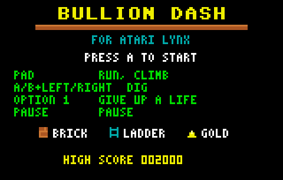
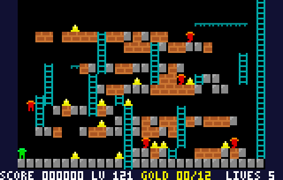

# Bullion Dash (Atari Lynx)

Port of `amiga_mcp/examples/bullion_dash` (amiga_games), with its repaired
levels and fixed guards: collect all the gold on the screen, dig holes in
the brick floors, keep away from the guards, then climb to the top row.
All 150 levels, five lives, 100 a gold, 1000 a level, and the original's
four-channel tune on Mikey.

 


```sh
./lynx build bullion_dash            # RELEASE=1: no harness log
./lynx run bullion_dash              # in a window
./lynx test bullion_dash             # a bot plays it (test.py)
```

## Controls

| Lynx | | window keys |
|---|---|---|
| d-pad | run, climb ladders, hang on bars | arrow keys |
| A or B held + LEFT / RIGHT | dig the brick below-left / below-right | Z or X + arrow |
| OPTION 1 | give up the life and restart the level (the original's R: the way out of a level that can't be finished any more) | 1 |
| A (title, game over) | start / back to the title | Z |
| PAUSE | pause / go on | P or Return |
| PAUSE, then OPTION 1 | back to the title (the Lynx's usual restart) | P, 1 |

## What was kept

`src/player.c`, `src/enemy.c`, `src/level.c` and `src/play.c` are the
original's `player.c`, `enemy.c`, `level.c` and `main.c` rules, statement
for statement, by way of the Atari 8-bit port (a8dev, the same cc65): the
original's 10 x 14 pixel coordinates, movement 2 pixels a frame, gravity,
bars, ladders, digging (10 frames), bricks growing back after 150 frames,
hidden ladders shown once all the gold is in, a level won on the top row
with all the gold. The guards are the fixed ones (`REPAIRED_LEVELS.md` in
the original): a step every 8 frames across and 10 up or down, along a
breadth-first path to the player; 3 s wait at the start of a level (one on
the player's row enters from the top); they fall into holes, die in a brick
that grows back and come back on the top row; they take gold (30%) and
drop it again after 3 s, only on a cell where gold lay at the start. The
150 levels are the original's repaired set (`tools/levels.txt`, checked
cell for cell against the Amiga `level.c`), 8.3 KB packed with gridpack
(`tools/gridpack.py`, `tools/pack_levels.py`). The rules run at the
original's 50 Hz. Changes are marked `port:` in the source; besides the
Lynx front end:

- **Gold drops**: the Amiga original sets the "gold lay here at the start"
  cells only in its editor's test play, so in a normal game its guards
  never drop stolen gold. This port sets them at every level's start, the
  rule its REPAIRED_LEVELS.md describes (as the Atari 8-bit and Spectrum
  ports do).
- **Buried**: a player under a brick that grows back, or off the bottom of
  the grid, dies (the original froze him there until a guard came); from
  the Spectrum port.
- **A high score**, kept while the Lynx is on (the original has none);
  shown on the title and the game over box.
- **PAUSE** (the original has none).
- The guards' random moves (when they have no path) use the SDK's xorshift
  instead of the original's 32-bit LCG.
- **Not ported**: the level editor (a keyboard tool: tile keys, file save
  and load) and the bridge hooks. The test starts a level by writing
  `start_level` before pressing A, as the original's `goto_level` hook did.

## The Lynx version

- **The whole level on screen, no scrolling.** 28 x 16 tiles of 5 x 6
  pixels make a 140 x 96 playfield, with the original's dark blue borders
  either side and its status line (SCORE, LV, GOLD, LIVES) in the 6 rows
  under it. Scrolling a 160 x 102 window over a full-size level would hide
  the guards and the gold the player has to plan around (the game is a
  puzzle about the whole board); half-width, 6/14-height tiles keep every
  tile type, the gold and the people readable. Positions are the
  original's, shown at x / 2 and y * 6 / 14.
- **Suzy sprites**: tiles (`art/tiles.txt`) are 4-bpp 5 x 6 sprites that
  paint their whole cell; the runner and the guards share one set of
  frames (`art/man.txt`: stand, run, climb, hang, dig, trapped) recoloured
  by each SCB's pen palette (green runner, red guards, the belt gold while
  a guard carries gold).
- **No per-frame clear.** A level is painted in full once (both screen
  buffers); then each buffer repaints only the cells whose tiles changed
  and the cells under people who moved or changed since it was last shown,
  and draws only those people (and anyone over a repainted cell). Suzy's
  cost here is mostly per sprite, so this keeps a typical frame to a few
  dozen sprites.
- **The status line is one 2-bpp sprite** whose characters the CPU writes
  (3x5 font); drawing it as text sprites cost ~90k cycles, more than a
  frame.
- **Sound**: the original's MOD-style tune (6 patterns, speed 6) on all
  four Mikey channels: square waves at the pitches its bass, lead and
  arpeggio samples made, noise for the drums. Effects take channel 3 for a
  few frames, as the original's `modplay_sfx` does: dig, gold, trap, death,
  level complete (the original builds these samples but never plays them;
  the Atari and Spectrum ports do).
- **Memory**: program, the levels and data end at `$B937` with a 1 KB C
  stack (`__STACKSIZE__`, locals are static); built with `-Or` (cc65's
  size optimisation).

## Speed

The rules and the music run at 50 Hz on a fixed timestep: after a frame
that took longer they catch up (at most 3 ticks), so the game keeps the
original's speed. The guards' path search (`src/gridbfs_run.s`, a
breadth-first distance field from the player kept while neither moves) is
the Atari port's 6502 with the neighbour visits inline, one pointer for all
four and a page-wise reset: when the player moves and a guard steps, a
search can still take most of a frame. Screens a second, debug build
with the harness log, the bot moving around: 47-50 on level 121 (five
guards), 48-50 on levels with one or two, 40-50 on level 100 (four guards
in a busy level); the log's `bd: perf frames=100 vbl=N` lines give it
(50 * 100 / N). A level start (unpack, path flags, full paint of both
buffers) takes about 0.15 s.

## Test

`./lynx test bullion_dash` (a few seconds headless):

1. The title; A starts level 1; the tune plays on Mikey; PAUSE stops the
   game and goes on. Level 1's guard catches the bot standing still (a
   life lost); OPTION 1 gives up the other four lives; game over, A back to
   the title. This session is recorded and replayed: every frame hash must
   match.
2. Level 1 with the guards taken out: the bot walks (route search,
   `tools/bdlevels.py`, the original's movement rules) to the nearest brick
   it can dig and digs it (B + direction): the hole is open, and the brick
   is back 150 frames later. Then it takes all the gold along the route
   search's moves (100 each) and climbs out: LEVEL COMPLETE, +1000; level 2
   the same; on level 3 OPTION 1 ends the game with a new high score, which
   the title shows.
3. Level 150 is won the same way and the game goes on at level 1; PAUSE +
   OPTION 1 goes to the title; level 121 has five guards, and the frame rate
   is measured while they chase the bot (at least 40 screens a second).

`.venv/bin/python games/bullion_dash/test.py --shots` rewrites the
pictures in `images/`.

## Files

| | |
|---|---|
| `src/player.c`, `enemy.c`, `level.c`, `play.c`, `game.h` | the original's rules |
| `src/gridbfs.c`, `gridbfs_run.s` | the guards' path search (distance field) |
| `src/gridpack.c`, `gpdecode.s`, `levels_data.c` | the 150 packed levels and their decoder |
| `src/main.c` | the original's main loop: states, title, pause, high score, log |
| `src/render.c` | the screen: tiles, people, status line, boxes, title |
| `src/sound.c` | the original's tune and effects on Mikey |
| `art/*.txt` | sprite art (`./lynx sprite art/tiles.txt -o src/spr_tiles.c --name tiles`) |
| `tools/` | levels (`levels.txt`, `levels_original.txt` as released), packer, route search |
