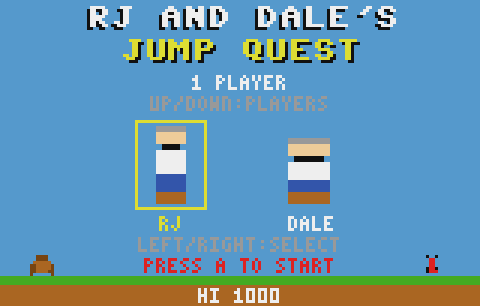
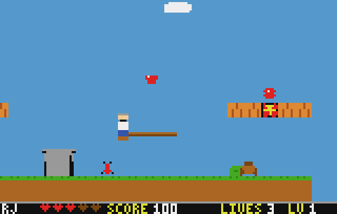
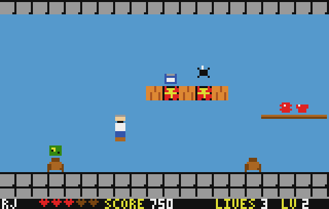
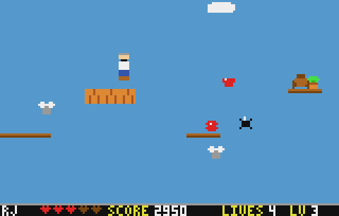
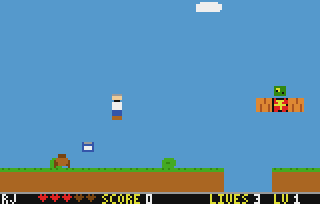

# Jump Quest (Atari Lynx)

Port of `amiga_mcp/examples/jump_quest` (by way of the ZX Spectrum and
Atari 8-bit ports' logic): RJ and Dale's side-scrolling platformer. Three
levels (the Office Park, the Server Room, the Rooftop) of beetles, flies,
spiders and ants. Stomp them for 200 points; circuit boards, diskettes,
balls, pillows and plants are 50-200; a ? block (a gift box) is 100; a
finished level is a 500 bonus. A briefcase makes you invulnerable for 3 s,
a heart heals, a pillow with ZZ is a life, beer or wine a speed boost. Five
hearts of health, three lives; one or two players taking turns.

 

 



```sh
./lynx run jump_quest              # in a window
./lynx test jump_quest             # bots play it headless (test.py)
./lynx build jump_quest RELEASE=1  # no harness log
```

## Controls

| Lynx | window key | |
|---|---|---|
| d-pad LEFT / RIGHT | arrow keys | run |
| A or B | Z / X | jump |
| LEFT / RIGHT (title) | arrow keys | RJ or Dale |
| UP / DOWN (title) | arrow keys | one or two players |
| A or B (title) | Z / X | start |
| PAUSE | P or Return | pause / go on |
| PAUSE, then OPTION 1 | P, 1 | give up, back to the title (the original's ESC) |
| A (game over, after 3-4 s) | Z | back to the title |

## What was kept

`src/jq.c` is the original's `player.c`, `enemy.c`, `items.c`, `level.c`
and `main.c` state machine, line for line where it could be (from the
Spectrum port, which the Atari 8-bit port shares): 10.6 fixed point,
gravity, the collision probes and snaps, one-way platforms, ? blocks, the
beetles' and ants' patrols with wall and edge turns, the flies' sine flight,
the spiders' drop and climb, the stomp and touch boxes, items, health,
invulnerability and its flashing, the speed boost, lives, two-player turns,
the dying (80 ticks), level-complete (100) and game-over (150 / 200)
timers, the original's camera (`cam_x`, still computed). The enemies, box
tests and tile lookups are the Atari port's 6502 (`src/enemies.s`,
`checks.s`, `tile_px.s`). The levels are the original's files
(`tools/levels/`, packed by `tools/gen_levels.py`). The logic runs at the
original's 50 ticks a second, one tick a frame (`gfx_set_rate(50)`).

The proof that it's the same game: the routes the Spectrum port's solver
found over this logic (`src/demo.h`) clear all three levels here without
losing a life, with the same score as on the Spectrum and the Atari, 4200
(the test checks it).

## What changed (marked `port:` in the source)

From the earlier ports (details in the a8dev port's `ORIGINAL_BUGS.md`):

- **the jump**: the original's `JUMP_FORCE` of -78 rises 14 pixels, but the
  levels need 32 (level 1's columns) to 48 (level 3's climbs): no one could
  finish level 1. -180 (56 pixels) is the Spectrum port's fix; the stomp
  bounce is half of it, as in the original.
- **score, lives and health carry on** from life to life and level to level
  (the original's `player_init()` reset them, so the game could never end).

For the Lynx:

- **The view** is the original's 320 x 224 playfield at half width and
  7/16 height: 16 x 16 tiles become 8 x 7, so all 14 rows fit (the clouds,
  the server room's ceiling) and the HUD takes the bottom 6 lines. Every
  picture is the original's RectFill / Draw code (transcribed in
  `tools/mkart.py`) scaled down by area.
- **It scrolls smoothly**, a Lynx pixel (two world pixels) at a time, with
  the original camera's target and easing; the original snapped its camera
  to whole tiles.
- **Items and enemies at the screen's edges** are drawn clipped (the
  original left out anything not wholly on the screen). All items bob in
  step (they did in the original too: they all start together), so one
  offset is kept instead of one per item.
- **HUD**: the original's two lines (name; hearts, SCORE, LIVES, LV) as one
  line of the 3x5 font.
- **Title**: the original's layout; the portraits are the game's sprites
  at 2x (Suzy's scaling), the decorative bugs are a beetle and an ant. The
  original's darker sky (only behind the portraits) is gone: the Lynx's
  pen 0 is transparent, so colour 1 is the sky.
- **Sound**: the original's tune (melody and bass, its patterns and song
  order, a row every 3 ticks) on Mikey channels 0 and 1, the notes from its
  Paula periods. Its sampled effects become Mikey tones and noise of the
  same shape on channels 2 and 3; they end (the original's repeated until
  the next one).
- **Added**: pause (PAUSE; PAUSE + OPTION 1 gives up, like the original's
  ESC), a high score kept until power-off (shown on the title and at game
  over), A or B both jump (the original took several keys).

## The Lynx version

- **One chain of Suzy sprites a frame**: the tiles in view, the items, the
  enemies, the hero (Suzy's HFLIP when he faces left), the death sparks.
  The chain's first sprite loads the pen palette; the rest reuse it
  (`SCB_RENONE` + `REUSEPAL`, 11 bytes each).
- **Tiles scroll with Suzy's HOFF register.** When a level starts, each
  non-sky tile gets an SCB at its place in the whole level, and runs of 2-4
  identical ground, grass, brick, stone or platform tiles share one wider
  sprite (level 2's 426 tiles are 145 sprites). A frame only links the
  ones in view: per row they are one run, found with a cursor that follows
  the view (`src/tiles.s`).
- **No clear**: each screen buffer has its own chain, and before the
  buffer's chain is rebuilt it is drawn once more with every pen mapped to
  the sky (one pen palette changed), which erases exactly what is there.
  Frames with text over the playfield clear in full.
- **Speed: 46-50 fps** (debug build, harness log on) over the three levels
  in the test; level 3 holds 50. A busy level-2 frame: game logic 17k
  cycles (the hero's C 8k, the enemies' asm 6.5k), building the chain 17k,
  erase 14k, draw 9k, of 80k. Late frames slow the game for that frame (two
  ticks in one frame didn't fit and made every following frame late too).
- Memory: program, data and BSS end at `$AF74` (of `$B837`); release
  cartridge 32.9 KB.

## Test

`./lynx test jump_quest`:

1. The title: RIGHT picks Dale, DOWN two players, back to RJ and one
   player; A starts; the level and the HUD are drawn; PAUSE stops the game
   (the hero doesn't move with RIGHT held) and goes on.
2. A bot runs right and jumps now and then: jumps, scores (items, ? blocks,
   stomps), dies three times (lives 2, 1, 0) and respawns, GAME OVER on the
   screen, A back to the title. The game is recorded and replayed: every
   frame's hash must match.
3. `jq_autoplay` (a test hook, harness builds only) makes the hero follow
   `src/demo.h`'s routes: LEVEL COMPLETE, the 500 bonus after each level,
   all three levels cleared without losing a life, CONGRATULATIONS with
   4200 points, a new high score on the title, and the frame rate from the
   game's `jq: fps=` lines (48+ average, never below 44).
4. Two players with Dale first: after Dale's three lives RJ takes over.

`.venv/bin/python games/jump_quest/test.py --shots` rewrites the pictures in
`images/`.

## Files

| | |
|---|---|
| `src/jq.c`, `jq.h` | the original's game logic |
| `src/enemies.s`, `checks.s`, `tile_px.s` | the enemies, box tests and tile lookups in 6502 (from the Atari port) |
| `src/main.c` | Lynx front end: the view, sprite chains, title, HUD, game over, pause, log |
| `src/tiles.s` | linking the tiles in view, the items', enemies' and sparks' sprites |
| `src/sound.c` | the tune and the effects on Mikey |
| `src/art.c` | the pictures, made by `tools/mkart.py` from the original's drawing code |
| `src/levels_data.c` | the levels, packed by `tools/gen_levels.py` from `tools/levels/` |
| `src/demo.h` | the solver's routes through the three levels (test hook) |
