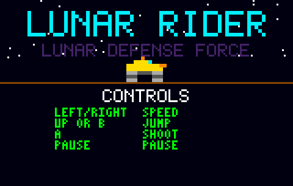
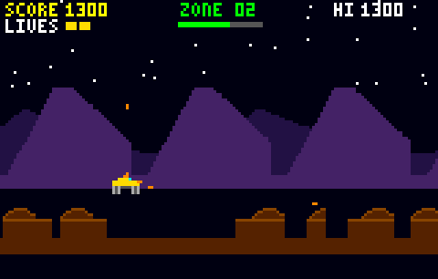
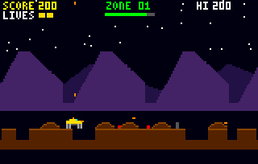

# Lunar Rider (Atari Lynx)

Port of `amiga_mcp/examples/lunar_rider`: drive a moon buggy along a
scrolling lunar surface with parallax mountains. Jump the craters and
rocks, avoid the mines, and shoot forward and upward at rocks, UFOs and
meteors. Rocks score 100, small UFOs 200, meteors 300, large UFOs 500
(two hits). There is a checkpoint every 500 pixels (+1000); after zone 26
the course starts again, harder. Three lives.

 



```sh
./lynx run lunar_rider              # in a window
./lynx test lunar_rider             # a bot plays it headless (test.py)
./lynx build lunar_rider RELEASE=1  # no harness log
```

## Controls

| Lynx | window key | |
|---|---|---|
| d-pad RIGHT / LEFT | arrow keys | speed up / slow down |
| UP or B | up arrow / X | jump |
| A | Z | shoot (forward and up) |
| A, B or UP (title) | Z | start |
| PAUSE | P or Return | pause / go on |
| PAUSE, then OPTION 1 | P, 1 | give up, back to the title (the original's ESC) |
| A (game over) | Z | back to the title (or wait 3.6 s) |

## What was kept

`src/game.c` is the original's `game.c`, with the changes marked `port:`.
It keeps the original's world (320 x 256) and units (speeds and the
buggy's velocity in 1/100 pixel). It also keeps:

- the terrain generator, its 64-pixel chunks and difficulty thresholds;
- the three speeds, the jump (-600), gravity (40);
- the crater, rock and mine tests at the buggy's centre and front;
- two forward and two upward bullets;
- small and large UFOs with their bombs, and meteors;
- the bomb's 20-pixel blast and the explosions;
- checkpoints with the 60-frame banner, and the loop with rising
  difficulty;
- the death, respawn and game-over timers (40 / 180 frames).

It runs at the original's 50 updates a second (`gfx_set_rate(50)`).

The screens are the original's: the title (logo, subtitle, buggy, ground
line, controls, blinking prompt), the HUD (SCORE, LIVES boxes, ZONE nn,
the checkpoint bar, HI), the ZONE nn / 1000 BONUS banner and GAME OVER
with the score. They use the original's 5x7 font for the big text and the
SDK's 3x5 font for the HUD. The palette is the original's 16 colours,
index for index.

Kept from the original even where it looks odd:

- HI shows the current score (the original has no high score).
- After a death the buggy respawns where it died.
- Rocks and mines are one pixel of terrain, so at speed the buggy often
  steps over them.
- At full speed the buggy coasts over a small crater without falling in.
- Enemies are rare at first: one try a second, a 2 % chance at difficulty
  0.

## What changed (marked `port:` in the source)

Bugs in the original, fixed here and reported:

- **the start area**: the original kept world x 0..30 clear, but the buggy
  stands at 80..104, so a game could start over a crater. Here the area
  up to 30 pixels beyond its front is kept clear (`src/gen.s`).
- **GAME OVER**: the original left GAME OVER and the title while fire was
  *held*. A player still holding fire never saw GAME OVER and went
  straight into a new game. Here these screens take a new press.
- **bullets vs rocks after 32768 pixels**: the original computed the
  bullet's world x in a 16-bit WORD, so from about zone 65 on it checked
  the wrong terrain. Here it uses the ring index.
- **the mountains** no longer jump every 2560 pixels: the original wrapped
  their parallax offsets at 640. A mine is drawn all the time; the
  original's dotted pattern hid a one-pixel mine on half of the columns.

For the Lynx:

- **The view** is the original's screen at half width and 2/5 height: the
  ground line at y 200 is Lynx line 80. Every picture is the original's
  RectFill drawing at that size (`tools/mkart.py`): the buggy with its two
  wheel frames, the UFOs pulsing cyan and white, the meteor, the bomb, the
  boulder, the mine and the hill's bump. Rocks and mines are drawn 2
  pixels wide so they can be seen; the collisions are still the
  original's.
- **Parallax**: the far and near ranges are the original's clipped
  triangle waves, sampled at its 2-pixel columns. Three far periods and
  five near periods are exactly 256 columns, so each range is one
  256-wide 1-bpp strip. Suzy draws the strip twice and it scrolls at 1/4
  and 1/2 of the ground's speed. The far strip is a background-type sprite
  (black between its peaks); the near range is drawn over it.
- **The title's buggy** is the game's sprite, scaled 2x by Suzy.
- **Sound**: Mikey plays square waves and noise at the pitches and lengths
  of the original's looped Paula samples. The channels are the original's:
  0 shots, 1 explosions and death, 2 jump (a rising sweep) and checkpoint
  (its four-note arpeggio, a note every 5 frames). Channel 3 plays the
  original's bouncy bass, a note every 7 frames.
- **Random numbers**: the SDK's xorshift (in asm) instead of the
  original's 32-bit LCG, so the courses differ from the Amiga's; their
  rules don't. A new terrain chunk is generated 16 pixels a frame over
  four frames. It is 420 pixels ahead, off the screen.
- **Added**: pause (PAUSE; PAUSE + OPTION 1 gives up, like the other Lynx
  ports). The title lists the Lynx controls instead of the keys and
  joystick port 2.

## The Lynx version

- **One chain of Suzy sprites a frame**, back to front:
  - the bands: sky, far peaks, mountain feet, gap, ground, dirt;
  - the 30 stars;
  - up to 32 terrain features (one SCB per feature, kept for its
    lifetime);
  - the bombs, enemies, bullets, the buggy and the explosions (two boxes
    each);
  - the HUD.
- **No full clear** (22,000 cycles a frame). The bands from line 32 down
  are repainted each frame. The sky above them (lines 0..31) is erased by
  black boxes over what this screen buffer showed two frames ago
  (`erase_save`). It is drawn whole only when text was over it, and the
  HUD's lines only when the score, lives or zone changed.
- **6502 where it counts** (`src/objs.s`, `src/gen.s`). In cc65 C these
  took a third of the frame:
  - writing the SCBs: objects 15k cycles → 4k, features 12k → 3.5k;
  - the terrain generator: 1,500 cycles a pixel → ~120;
  - the random numbers.
- **Speed**: 50 fps. Over 3000 frames (60 s) of the bot riding at full
  speed and shooting, it measured **49.85 fps** in the debug build and
  **49.97** in the release build; the worst 100-frame window was 49.5. A
  busy frame is about 48,000 of 80,000 cycles: Suzy ~27k, game logic
  ~6k, the SCB updates ~10k. A checkpoint frame is ~60k. The one frame
  that builds the GAME OVER text is late, once a game.
- Memory: release cartridge 29 KB.

## Test

`./lynx test lunar_rider` runs two games.

**A recorded game**:

1. The title: the cyan logo, the bass playing on Mikey channel 3. A
   starts; the HUD, ground and mountains are drawn.
2. PAUSE stops the scroll; PAUSE again goes on.
3. A bot (`tools/bot.py`) drives. It plans its jumps with the game's own
   rules, reading the terrain ring by symbol. It rides at full speed
   holding A to zones 2, 3 and 4 and shoots rocks.
4. It stops jumping and the three lives go: causes logged, lives 3, 2, 1,
   two respawns.
5. GAME OVER stays while A is held; a new press goes back to the title.
6. The test checks that every score line adds up, and the frame rate
   (5 windows of 100 frames, all 50 fps).
7. The game is replayed: every frame hash must match.

**The enemies** (they are rare, so the test writes them into the enemy
arrays):

- a small UFO, a large UFO (two hits) and a meteor over the buggy are
  shot: 200, 500, 300;
- a UFO drops its bomb on its timer;
- a bomb landing by the buggy kills it.

`.venv/bin/python games/lunar_rider/test.py --shots` rewrites the pictures
in `images/`.

## Files

| | |
|---|---|
| `src/game.c`, `game.h` | the original's game logic |
| `src/gen.s` | the terrain generator's loop and the random numbers in 6502 |
| `src/objs.s` | per-frame SCB writes (objects, features) and the sky erase boxes |
| `src/main.c` | Lynx front end: the chain, HUD, title, checkpoint and game-over screens, sound, pause, log |
| `src/art.c` | the pictures, mountain strips, font and stars, made by `tools/mkart.py` |
| `tools/bot.py` | the test's driver |
