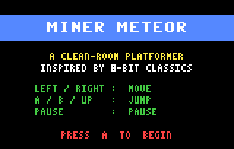
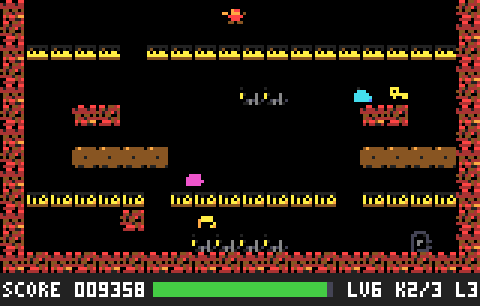
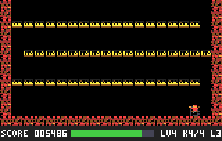

# Miner Meteor (Atari Lynx)

Port of `amiga_mcp/examples/miner_meteor`, a single-screen tile platformer:
in each of six caverns collect every key to unlock the exit, then reach it
before the air runs out. Spikes, conveyor belts, floors that crumble a few
frames after you step on them, and guardians patrolling the ledges. 100
points a key, 1000 a cavern plus half the air left. Three lives; a death
restarts the cavern.

 



```sh
./lynx run miner_meteor              # in a window
./lynx test miner_meteor             # the bot and the routes, headless (test.py)
./lynx build miner_meteor RELEASE=1  # no harness log
```

## Controls

| Lynx | window key | |
|---|---|---|
| d-pad LEFT / RIGHT | arrow keys | walk |
| A, B or UP | Z, X or up arrow | jump |
| A or B (title, end screen) | Z / X | begin / back to the title |
| PAUSE | P or Return | pause / go on |
| PAUSE, then OPTION 1 | P, 1 | give up, back to the title (the original's ESC quits) |

## What was kept

`src/game.c` is the original's `game.cpp` (the `MinerGame` rules as C over
one `GameState`), taken unchanged from the Atari 8-bit port (a8dev
`projects/miner_meteor`, itself the ZX Spectrum port's), with
`src/plat.c`/`tmap.c` holding the original's `update_player` collision code
and `src/levels.txt` its six caverns row for row (with the three rows the
original fixed). Gravity, the jump and its edge trigger, walk and conveyor
speeds, the collision snaps, the 18-tick crumbling floors, the guardians'
patrols and hit boxes, the air draining one unit every 6 ticks, the
scoring, three lives and the 60 / 150 / 200-tick screens are the original's.
The logic runs at its PAL rate, one tick a frame at 50 Hz.

The proof that it plays the same: the Spectrum port's solver found the
fastest route through each cavern over this logic (`tools/routes.json`);
test.py feeds the routes in through the pad and all six caverns are
cleared without a death, each in exactly the route's number of ticks.

The screens follow `render.cpp`: the tiles and sprites come from the
original's tile sheet (its baked `tilesheet_data.cpp`, `art/sheet16.txt`),
with its palette; the miner's walk frames by direction, its jump and fall
poses, the guardians' 8-frame animations in three colours, the collapsing
floor darkening in the second half of its timer, the exit blinking open
every 6 ticks once the last key is taken. The HUD has the original's
SCORE, air bar (red below a quarter) and `LV1 K0/4 L3`; the title and the
end screens have its text and colours.

## What changed (marked `port:` in the source)

- **The view**: the original's 320 x 240 cavern at half width and 7/16
  height: 16 x 16 tiles become 8 x 7 (`tools/mkart.py` takes each Lynx
  pixel's colour from the 2 x 2.3 original pixels under it). Rows 1-13 fill
  lines 0-90; row 0 (the ceiling, solid in every cavern) and row 14 (a
  second row under the floor) are left off, and the HUD takes the bottom 11
  lines as the original's took its bottom 16.
- **A second black** (colour 13, the original's light green, which only its
  unused decorations have): the Lynx can't draw pen 0, so black inside a
  sprite (eyes, mouths) is colour 13.
- **Sound**: the original's `audio.cpp` is a stub that logs its effect
  triggers. Here they are Mikey jingles and noise: jump, key, death, cavern
  cleared, plus game over and the win.
- **Pause** (PAUSE) and giving up with PAUSE + OPTION 1, as in the other
  Lynx ports. Controls on the title say A / B / UP and PAUSE instead of
  SPACE and ESC.
- **The score** is formatted as 16 bits (six caverns score at most about
  13,000); the logic keeps the original's 32-bit score.
- tmap_count / tmap_find search in 6502 (`src/tmap_scan.s`): the C took
  three frames when a cavern loads.

## The Lynx version

- **Drawn once, then only what changes.** A cavern is drawn in full (a
  chain of its non-empty tiles after a clear) when it loads, in both
  screen buffers. After that each frame draws one Suzy chain: for the
  buffer being drawn, a black box and the tile for every dirty cell (the
  cells its sprites covered when that buffer was last drawn, plus cells
  whose tile changed: a key taken, a crumbling floor, the exit blinking),
  then the guardians and the miner. A typical frame is 3-17 sprites. The
  first sprite loads the pen palette; the rest reuse it (`SCB_RENONE` +
  `REUSEPAL`). The HUD is one prebuilt chain (strip, air bar, 23 font
  characters whose pictures change) drawn only when it changed.
- **Speed: 50 fps.** A cavern frame in Guardian Alley takes about 37,000
  of the 80,000 cycles (the miner's movement 8k, the guardians 2k, the
  dirty cells 13k, four sprites 10k). Loading a cavern (or restarting it
  after a death) takes two frames, one tick a frame late. Over the six
  caverns: 49.9 fps in a release build (5 late frames in 2,323), 49-50 in
  the harness build.
- Memory: program, data and BSS end at `$9724` (of `$B837`); the release
  cartridge is 26.9 KB.

## Test

`./lynx test miner_meteor` (`test.py`):

1. Title (checked on screen), then a bot game recorded from reset: the
   route through cavern 1 (four keys at 100, the cavern bonus 1000 + half
   the air), PAUSE in cavern 2 (the miner doesn't move, PAUSED on screen),
   then walking into the spikes three times (lives 2, 1, 0, the cavern
   restarting each time), GAME OVER, A back to the title. The recording is
   replayed: every frame hash matches.
2. The routes through all six caverns: each cleared in the route's ticks
   with the original's score, no death, ALL CAVERNS CLEARED; the frame rate
   from the game's `mm: fps=` lines (49+ average, never below 48).
3. The same routes with the whole cavern redrawn every frame: at 60+
   points the buffer just drawn is byte for byte the dirty-cell one.
4. B starts a game; PAUSE, OPTION 1 gives up.

The bot sets the pad at a breakpoint on `input_update()` from the game's
tick counter, so its inputs land on the route's ticks whatever the frame
timing. `.venv/bin/python games/miner_meteor/test.py --shots` rewrites the
pictures in `images/`.

## Files

| | |
|---|---|
| `src/game.c`, `game.h` | the original's rules (from the Atari 8-bit port) |
| `src/plat.c`, `tmap.c`, `tmap_scan.s` | its collision code and the tile map |
| `src/levels.txt`, `levels_data.c`, `levels.c` | the caverns (`tools/mklevels.py`) and their guardians |
| `src/main.c` | Lynx front end: drawing, HUD, title and end screens, pause, log |
| `src/art.c` | tiles and sprites, made by `tools/mkart.py` from `art/sheet16.txt` |
| `src/sound.c` | the effects on Mikey |
| `tools/routes.json` | the solver's routes (the test plays them) |
