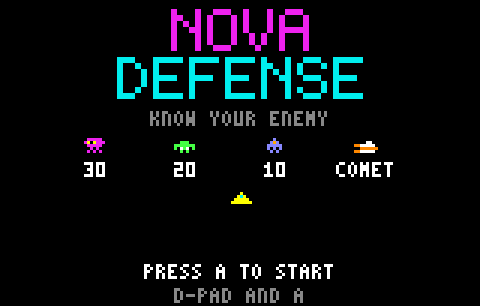
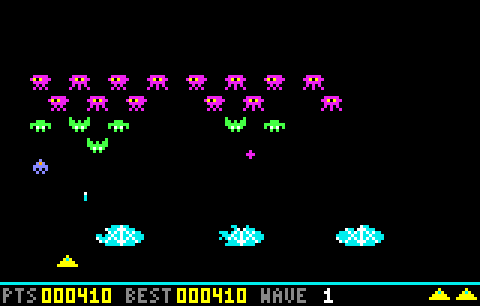
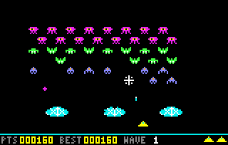

# Nova Defense (Atari Lynx)

Port of `amiga_mcp/examples/nova_defense`: defend the base against a
staggered swarm of 48 aliens in three kinds (eye pods 30, rays 20, spore
crawlers 10 points), a bonus comet crossing the top (50 / 100 / 150 / 300),
three crystal shields that erode where they are hit, and waves that start
faster each time. The swarm marches faster as it thins out; if it reaches
the gun, the game is over.

 



```sh
./lynx build nova_defense            # RELEASE=1: no harness log
./lynx run nova_defense              # in a window
./lynx test nova_defense             # a bot plays a game (test.py)
```

## Controls

| Lynx | | window keys |
|---|---|---|
| d-pad LEFT / RIGHT | move the gun | arrow keys |
| A or B | fire (one shot on the screen at a time, a press a shot, as the original) | Z or X |
| A or B (title) | start | Z |
| PAUSE | pause / go on | P or Return |
| PAUSE, then OPTION 1 | back to the title (the Lynx's usual restart) | P, 1 |
| A or B (game over) | back to the title (or wait 3 s) | Z |

## What was kept

`src/game.c` is the original's logic (by way of the Atari 8-bit port's
speed-ups, which give the same results), in the same order every frame:
the swarm's march speed-up (frames per step and pixels per step by the
number left), the drop and turn at the edges, the swept bullet test, the
lowest alien in a random column fires, the firing rate per wave (30 frames,
5 less each wave, at least 8), the step delay (2, or 1 from wave 3), three
alien bullets at most, the comet's timers (300-700 frames, then 400-1000)
and scores, the shields eroding where a bullet hits and where the aliens
overlap them, the 60-frame death (the gun blinks, nothing moves), the
90-frame wave clear, three lives, the high score. It runs at the
original's 50 Hz (`gfx_set_rate(50)`), one update a frame. The pictures
(aliens in two frames, neighbouring columns flapping out of step; the gun,
the comet, the spinning spores, the expanding-cross explosions; the 5x7
font of the title and messages) and colours are the original's at half
size. Changes are marked `port:` in the source.

## The Lynx version

- **The world** is the original's 320 pixels across, shown at half size, so
  every sideways speed and size is the original's. Vertically the world is
  204 (2 world pixels a display line; the original's screen was 256), so
  the layout is squeezed: alien rows are 14 apart (were 15), odd rows are
  shifted 12 (13: whole pixels at half size), and the swarm drops 4 (was
  6) so it takes the original's 12 drops to reach the shields and 17 to
  reach the gun. The bullets keep the original's flight times over the
  shorter distances (8 and 2 pixels a frame, were 10 and 3).
- **Everything in play is a Suzy sprite**, one chain of 65 SCBs: the three
  shields, 48 aliens, the comet, the gun, four bullets, eight explosions.
  The aliens, gun and comet are 2 bits a pixel, their body and accent
  colours from each SCB's pen palette as in the original.
- **The shields** are background-type sprites whose data the game rewrites
  when one is hit (16 x 7 pixels, 2 bits a pixel; port: the original's
  32 x 14 pixels at half size, a hit clears a plus of 5 where the original
  cleared a disc of 21 world pixels).
- **No full-screen clear in play.** There are two SCB sets, one per screen
  buffer; each frame first draws the set that went into this buffer two
  frames ago with REUSEPAL set on every SCB, behind an off-screen head
  whose pen palette maps every pen to the background: that erases exactly
  what is there. The status line is drawn only when it changes. Frames
  with text over the play (wave clear, pause) clear in full.
- **The status line** keeps the original's bottom bar (PTS, BEST, reserve
  guns); port: WAVE (top right in the original) joins it. The digits are a
  fixed chain of sprites in the SDK's 3x5 font.
- **Sound** (Mikey, the original's Paula channels): channel 0 the march's
  three rising notes, 1 the shot and the explosions (noise), 2 the comet's
  rising whoosh (restarts every 32 frames), 3 the background arpeggio
  (16 notes, 12 frames each, always on). The original played 32-sample
  waves; Mikey plays square waves and noise at the same pitches (period p
  -> 3546895 / 32p Hz) and lengths, volumes doubled to Mikey's 0-127.

Other `port:` changes: the SDK's xorshift random numbers instead of the
32-bit LCG; the score is also kept as 6 decimal digits (no 32-bit divides
to show it); alien bullets end at the status line; the sound events last
one frame in every state (the original cleared them only in play, so while
the gun was dying the explosion restarted every frame); PAUSE (the Lynx's
button) pauses, as in the other Lynx ports; the title says D-PAD AND A
(was MOUSE AND KEYBOARD). Not ported: the original's mouse control.

## Speed

The game holds **50 fps**: the log's `nd: fps=` lines (every 2 s in play)
report frames drawn, late frames and the busiest frame in display lines
(out of 105). The test's bot game (debug build, harness log on): 50 fps
with 0 late frames in every 2-second window through three waves, except
2 late frames when a wave starts (both buffers cleared in full); the
busiest frame uses 84 of 105 lines, a quiet one with the full swarm ~70.

What it took (measured with the harness's cycle counts; a 50 Hz frame is
~80k cycles): the 48 aliens' SCBs and the erase pass's flags in 6502
(`src/objs.s`; in C they were ~8k cycles a frame), the status line's
numbers as a fixed sprite chain instead of `text_small` (~10k cycles on a
frame with a hit), no printf in play (`lynx_log_s` and a subtract-loop
number), bit masks and tables for the swarm (from the Atari 8-bit port).

Release build: 24 KB cartridge; program, data and BSS end at `$7231`
(`build/nova_defense.map`).

## Test

`./lynx test nova_defense`: the title (the NOVA logo, the arpeggio on
Mikey channel 3), A starts wave 1 with 48 aliens, the status line and the
shields are drawn, the march plays on channel 0, PAUSE stops the swarm and
PAUSE goes on. Then a bot reads the game by symbol (`alive_mask`, `grid_x`,
`grid_y`, `player_x`, `bul_*`, `shield_px`, `ufo_*`): it goes under the
nearest alien of the lowest row, fires whenever a shot from where it
stands would meet an alien or the comet (leading the march, never into its
own shields), and dodges the alien bullets in wave 1. Checks: 30 / 20 / 10
points by row, a comet shot down (50-300), wave 1 cleared, wave 2, a life
lost, game over with the last score and the high score, frame rate (50
average, never below 40), GAME OVER on screen, back to the title with the
high score shown, and the whole game is recorded and replayed with every
frame's hash matching. The bot's game: 147 shots, three waves, 2940
points. `.venv/bin/python games/nova_defense/test.py --shots` rewrites the
pictures in `images/`.

## Files

| | |
|---|---|
| `src/game.c`, `game.h` | the original's game logic |
| `src/main.c` | Lynx front end: sprites, erase pass, status line, title, game over, sound, pause, log |
| `src/objs.s` | per-frame loops (the swarm's SCBs, the erase flags) in 6502 |
| `src/art.c` | sprites made by `tools/mkart.py` from the original's art |
