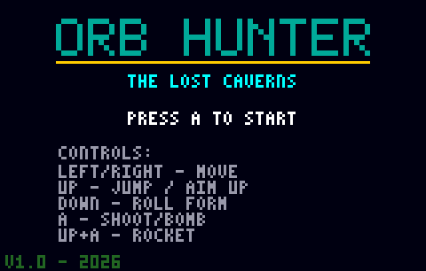
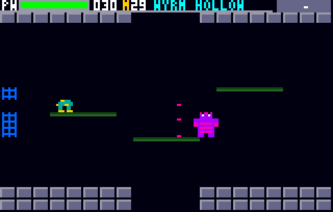
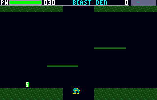

# Orb Hunter (Atari Lynx)

Port of `amiga_mcp/examples/orb_hunter` (amiga_games), by way of the Atari
8-bit port's logic: explore the lost caverns. Its world is 8 x 6 rooms of
20 x 16 tiles (a screen each): caverns, magma halls, corridors, the
citadel, the dens of two bosses. Shoot the creatures (100 points, a boss
2000), collect the power-ups (power cells, rocket packs, the roll form and
its bombs, the far shot, the frost ray, spring boots, the spin strike, the
heat suit) and don't let your energy run out: one life, as in the original.

 



```sh
./lynx run orb_hunter              # in a window
./lynx test orb_hunter             # a bot plays it headless (test.py)
./lynx build orb_hunter RELEASE=1  # no harness log
```

## Controls

The original's joystick: up is jump (and aims up, so up + fire is a
rocket); the Lynx's A and B are its fire button.

| Lynx | window key | |
|---|---|---|
| d-pad LEFT / RIGHT | arrow keys | run |
| UP | up arrow | jump (higher with the spring boots; let go early for a short one); stands up from the roll form |
| DOWN | down arrow | roll form (once found), standing still on the ground |
| A or B | Z / X | shoot; rolled: a bomb (once found) |
| UP + A | up + Z | a rocket (once found): opens the barred doors |
| A (title, item box, GAME OVER) | Z | start, close the box, back to the title |
| PAUSE | P or Return | pause / go on |
| PAUSE, then OPTION 1 | P, 1 | back to the title |

## What was kept

`src/game.c` is the original's `game.c`, its rules in its order (from the
Atari 8-bit port, the same cc65): the hunter's running and jumping and the
short jump when UP is let go, gravity, one-way ledges, lava (5 a touch, 1
with the heat suit), the roll form and standing up under low ceilings,
beams (the far shot's longer and stronger), rockets that open the barred
doors, bombs and the bomb jump, the six creatures' behaviour (crawlers,
flyers, hoppers, turrets, the beast and the drake), the power-ups, the
scores, the moves from room to room (a room's creatures come back when it is
entered), the energy (30, +30 a power cell, 5 a hit). Its 16.16 fixed point
is 12.4 here: every value its rules use is a multiple of 1/16 of a pixel, so
they are the same numbers. The world is the original's own: its `levels.c`
compiled on the host (`tools/gen_world.py`) and the 48 rooms run-length
coded (1.5 KB instead of 15 KB, the current room decoded when it is
entered, the doors a rocket opened kept in a list); the test checks the
start room against it byte for byte. The rules run at the original's 50 Hz.
The original's tune (`rock_blaster.mod`, which it loads) plays on two Mikey
channels, its effects on the other two, as its ptplayer keeps two of four
for music.

## What changed (marked `port:` in the source)

Bugs in the original, fixed here (reported for amiga_games):

- **The creatures were never drawn.** The original's frame counter goes up
  twice a loop, so its drawing always sees it odd, and its "flash when hit"
  test (`e->timer > 0 && (g_frame & 1)`; every creature's timer runs) hides
  every creature, turret and boss: only their shots show. The same test hid
  the hunter for all of his invulnerability instead of flickering. Here the
  creatures are always drawn and the hunter flickers.
- **Fire held, not pressed**: the title, the item box and GAME OVER react
  to the fire button being down, so the shot that was firing when the hunter
  touched an orb closes its box at once, and fire held through GAME OVER
  starts the next game. Here they wait for a press.
- **The title's controls** said "START - MISSILE MODE"; a rocket is up +
  fire and START does nothing in play. Here: "UP+A - ROCKET".
- **The score** is kept but never shown; GAME OVER shows it here.

Left as the original has them:

- The bomb jump sets the hunter going up at 3 pixels a frame, but the short
  jump rule halves that every frame UP isn't held (and UP on the ground
  stands the roll form up), so in the open it is a hop of a pixel or two.
- The barred doors fill only the doorway: the rooms' edges outside it are
  open (levels.c builds walls only where there is no neighbour), so the
  beast's den can be walked into along the floor.
- The area names go by the room's row ("BEAST DEN" in the start room), the
  save point does nothing, the citadel's creatures stand inside its floor,
  the frost ray is the beam with power 2.

The Lynx version:

- **The whole room on screen**: 20 x 16 tiles of 8 x 6 pixels make a
  160 x 96 room under a 6-row HUD (the original's 320 x 256 at x / 2 and
  y * 3 / 8; its HUD covered the room's top tile row and its bottom row was
  off the screen). The rules keep the original's pixels.
- **Suzy sprites**: tiles (`art/tiles.txt`, the original's designs at 8 x 6,
  the lava's wave in four phases), the hunter and his roll form, the
  creatures and both bosses, orbs, beams and rockets (`art/*.txt`, drawn
  from the original's rectangles), the title's and GAME OVER's words in the
  original's own 5x7 font (`tools/mkart.py`), scaled 2x by Suzy. Bombs,
  shots and sparks are boxes.
- **No per-frame clear**: a room is painted in full when it is entered
  (a clear and its tiles that aren't empty), then each screen buffer
  repaints only the cells that what it showed two frames ago covered, plus
  the lava and the save point when they animate and the doors a rocket
  opens. The HUD redraws only what changed.
- **Colours**: the original's 16. Its second yellow (0xFF0, the rockets and
  the HUD's M) is its other yellow (0xFC0) here: palette entry 10 is the
  background colour again, because Suzy doesn't draw a pixel whose pen maps
  to colour 0 and a tile has to paint its black.
- Effects: the original's eight samples as Mikey tones and noise of the
  same shape and priority (a falling blip for a shot, a rising one for a
  jump, the item's three notes, the door's sweep, noise bursts).
- **PAUSE** (the original has none; Esc quit it).
- Not ported: the debug line in the original's HUD (the hunter's y, the
  room), the bridge hooks (the test gives the power-ups by writing the
  variables its `give_items` hook sets), the keyboard.

## Speed

Measured by the test from the game's `oh: perf` lines (display frames per
100 drawn), debug build with the harness log: **50 screens a second** in
play (every 100-frame window without a room change, the bot shooting,
sparks flying; the beast's den with its spreads), 48.5 on average over the
bot's whole game, which goes in and out of rooms. Entering a room costs
about two frames (a clear and up to a few hundred tiles in each buffer);
the rules catch up afterwards (at most 3 steps a frame), so they run at
49.8-50 Hz.

The hot loops are 6502 (`src/render_asm.s`): the tile pool and repaint
list, the cells an object covers, the sparks (from ~3,500 cycles an
object in C to a few hundred), and the tile tests at a pixel (`src/props.s`,
the Atari port's). Memory: program, data and BSS end at `$A978`.

## Test

`./lynx test orb_hunter`:

1. The title (the logo in the hunter's teal, the tune on Mikey); A starts in
   room 2,2, which is the original's (levels.c compiled on the host when
   the Amiga source is there); PAUSE stops the game's frame counter, PAUSE
   goes on.
2. The bot (`tools/bot.py`) runs right, down the gap into the caverns,
   shoots the creatures (100 each), takes the Spring Boots in room 3,3 (the
   box closes on A), then walks into the creatures until its energy is
   gone: dead, GAME OVER with the score, A, the title.
3. That session, recorded from reset, is replayed: every frame hash
   matches.
4. The power-ups as the original's `give_items` hook gives them: DOWN rolls,
   A lays a bomb that blows and pushes the hunter up, UP stands up; in the
   beast's den UP + A fires a rocket (one fewer) that opens the barred door;
   the beast walks and fires its spreads at 50 screens a second.

`--shots` rewrites `images/` (title, the den, the GIF of the bot's game).
