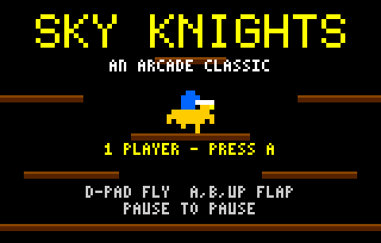
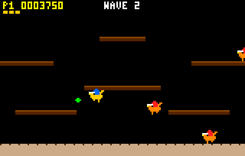
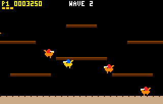

# Sky Knights (Atari Lynx)

Port of `amiga_mcp/examples/sky_knights`: joust on flying mounts. Flap to
climb and meet the enemy knights from above: the higher knight wins (level,
both bounce off). A downed enemy drops a pod; take it before it cracks open
into a stronger enemy. Swoopers wander, raiders and wraiths hunt you down,
and each wave brings one more of them (eight from wave 6). Three lives.

 



```sh
./lynx build sky_knights            # RELEASE=1: no harness log
./lynx run sky_knights              # in a window
./lynx test sky_knights             # a bot plays a game (test.py)
```

## Controls

| Lynx | | window keys |
|---|---|---|
| d-pad LEFT / RIGHT | fly left / right | arrow keys |
| A, B or UP (hold) | flap: every frame held lifts you more | Z, X or up arrow |
| A or B (title) | start | Z |
| PAUSE | pause / go on | P or Return |
| PAUSE, then OPTION 1 | back to the title (the Lynx's usual restart) | P, 1 |

Scoring is the original's: swooper 500, raider 750, wraith 1000, a pod 250,
a cleared wave 1000 if you are flying when it ends. Game over goes back to
the title after 4 seconds, as the original.

## What was kept

`src/game.c` and `src/physics.s` are the original's rules, by way of the
Atari 8-bit port (`a8dev/projects/sky_knights`), which made them fast on a
6502: the seven ledges, the flap physics (impulse spread over the frames
the button is held, gravity, top speeds, friction), wrapping at the sides,
the ceiling, the ledge undersides, the joust rule (more than 2 pixels higher wins),
pods falling onto ledges, flashing from 240 frames left and shaking in the
last 60, hatching into the next type up, each wave's mix (swoopers; then
raiders; wraiths from wave 5), the enemies' flap timers, the raiders and
wraiths turning to the knight every 64 frames, the swoopers' random turns,
the 100-frame respawn and wave intro, the 200-frame game over. It runs at
the original's 50 Hz (`gfx_set_rate(50)`), one update a frame, in the
original's 320 x 256 world, so every distance, speed and time is the
original's; only the drawing is scaled. The screens (title, wave intro,
play, game over), the colours and the status line are the original's.
Changes are marked `port:` in the source.

## The Lynx version

- **The world** is drawn at x / 2, y * 2 / 5: the original's 320 x 256
  screen fits the Lynx's 160 x 102 exactly. A knight (the original's 20 x
  22 box of rectangles: rider, lance, mount, beak, wings, legs) is a 10 x 9
  Suzy sprite in four pictures, as the original: wings up while flapping
  or down, two leg steps; facing left is the same picture flipped by Suzy.
  The pictures are 3 bits a pixel and each SCB's pen palette gives the
  mount and rider colours, as the original's body / knight colour pair
  (yellow and blue for you; orange and red swoopers, grey raiders, dark
  blue wraiths). Pods are 4 x 3, recoloured as they flash.
- **One sprite chain a frame**: the ledges, 8 pods, 8 enemies and the
  knight, then the status line. **No full-screen clear in play**: there are
  two sets of the moving objects' SCBs, one per screen buffer, and each
  frame first draws the set that went into this buffer two frames ago with
  every pen mapped to the background (REUSEPAL behind an off-screen head),
  which erases exactly what is there; then the ledges and the new set.
  The title, wave intro and game-over screens don't move (but the title's
  knight), so they are drawn into both buffers once.
- **The status line** (`P1 0000000`, the lives, `WAVE n`) is a fixed chain
  of sprites in the SDK's 3x5 font whose pictures change with the score;
  the score is also kept as 7 decimal digits (no 32-bit divides).
- **Sound** (Mikey, the original's Paula channels): 0 the wing beat while
  flapping (the original looped its flap sample; here a noise beat every 8
  frames), 1 the joust and a lost knight (noise; the original's crunch
  sample and noise wave), 2 a pod and the wave fanfare, 3 the original's
  32-note tune (9 frames a note, always on). Paula periods are converted
  to the same pitches (a 32-sample wave at period p is 3546895 / 32p Hz).

Other `port:` changes: one player (the Lynx has one joypad; the original's
second player used the Amiga's second joystick port), so the title says
`1 PLAYER - PRESS A` (was F1 / F2) and the status line has no P2; 16-bit
fixed point (1/64 pixel) instead of 16.16, every constant exact except
gravity (0.3 = 19.2/64: 19, and 20 every fifth frame); the SDK's xorshift
and an 8-bit LFSR for the dice instead of the 32-bit LCG; `rng() % n` with
Suzy's divider; PAUSE (the Lynx's button) pauses, as in the other Lynx
ports; the title's knight is drawn at twice the size; the title's help
lines name the Lynx's buttons (were P1 ARROWS + SPACE, ESC TO QUIT).

**Original bug fixed** (`port: original bug`): the original drew the lance
and the mount's head on the left for a knight flying right and on the right
for one flying left, so every knight flew backwards; here they point the
way the knight flies (as the Atari 8-bit port).

## Speed

The game holds **50 fps**: the log's `sk: fps=` lines (every 2 s in play)
report frames drawn, late frames, the busiest frame in display lines (out
of 105) and the enemies and pods in play. The test's bot game (debug
build, harness log on) runs 50 fps with no late frame in any window
through four waves; wave 6 (eight enemies, the most there can be) 50 fps,
no late frames. A frame of play costs ~27k cycles of the 80k a 50 Hz
frame has (wave 6, eight enemies); the busiest is a wave's first frame
(the eight enemies placed, the intro's message wiped): ~70k.

What it took (measured with the harness's cycle counts): the Atari 8-bit
port's 6502 physics (`physics.s`: one body step ~300-500 cycles, 3-6k in
C), the erase pass instead of a clear (~25k cycles a frame), the status line
as a fixed chain (text_small was ~1.3k cycles a character), the static
screens drawn once (the title redrawn every frame took 2-3 frames), Suzy's
divider for the spawn positions (cc65's 16-bit modulo cost ~2k a call),
no printf in play (`lynx_log_s` and a subtract-loop number).

Release build: 25 KB cartridge; program, data and BSS end at `$70F5`
(`build/sky_knights.map`).

## Test

`./lynx test sky_knights`: the title (SKY KNIGHTS in yellow, the knight on
its ledge, the tune on Mikey channel 3), A starts wave 1 with the
original's three swoopers, the wave intro, the ground and ledges and the
knights drawn, flapping plays the wing beat on channel 0, PAUSE stops the
game and PAUSE goes on. Then a bot reads the game by symbol (`b_px`,
`b_py`, `b_dy`, `e_active`, `g_x`, `g_y`, `gs`): it takes the pods (in wave
2 it leaves them until one hatches), otherwise flies 30 pixels above the
nearest enemy and drops onto it, and once it has 12000 points it flies
level with the enemies until it has lost its lives. Checks: the first joust
is a swooper's 500, every joust 500 / 750 / 1000, the score adds up frame
by frame (jousts, 250 a pod, 1000 a cleared wave), wave 2 starts with four
enemies, a pod hatches, wave 3 brings raiders, three lives lost, game over
with the last score, 50 fps in every window, GAME OVER on screen and the
title 200 frames later. The whole game is recorded and replayed with every
frame's hash matching. Then wave 6 is poked in: eight enemies (2 swoopers,
2 raiders, 4 wraiths) and 50 fps. `.venv/bin/python
games/sky_knights/test.py --shots` rewrites the pictures in `images/`.

## Files

| | |
|---|---|
| `src/game.c`, `game.h` | the original's game logic (16-bit fixed point, arrays of fields) |
| `src/physics.s` | the bodies' physics, the enemies' step, the joust overlap tests in 6502 (from the Atari 8-bit port) |
| `src/main.c` | Lynx front end: sprites, erase pass, status line, screens, sound, pause, log |
| `src/art.c` | sprites and the y table, made by `tools/mkart.py` |
